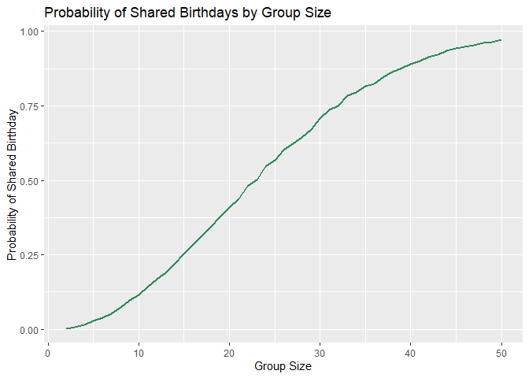
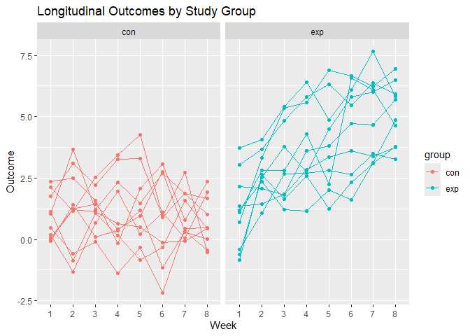
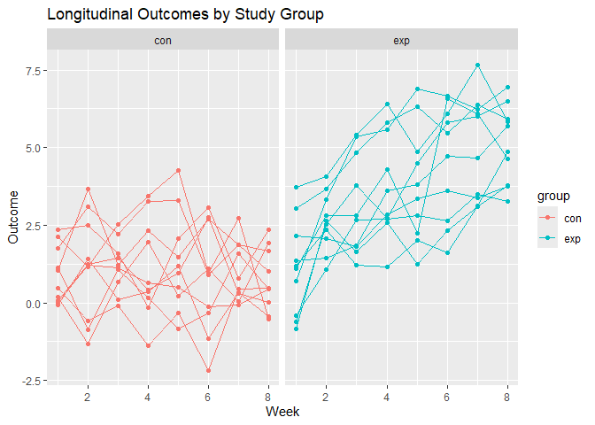
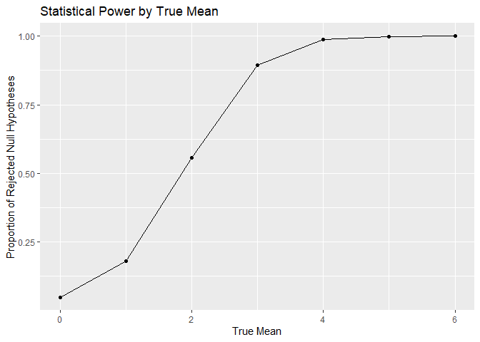
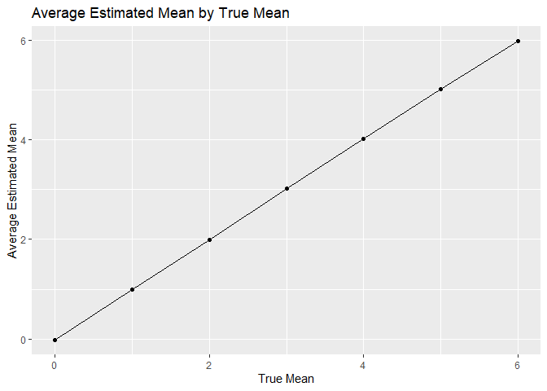
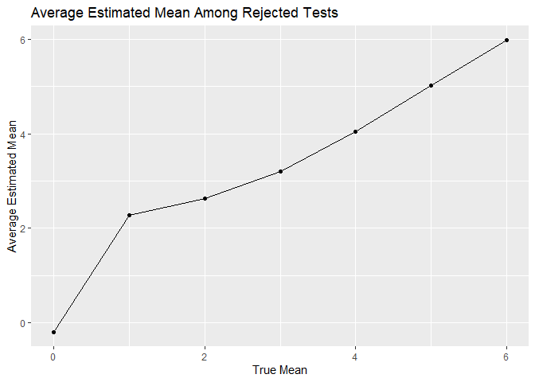

P8105 Homework 5
================
Astrid Xu
2026-11-18

## Q1 Birthday Simulation

``` r
# Randomly sample n birthdays from 1–365. If the number of unique birthdays is less than n, then True at least two people share the same birthday; if false, unique birthdays number should = n.

birthday_sim = function(n) {

  birthdays = sample(1:365, size = n, replace = TRUE)

  n_unique = length(unique(birthdays))

  same_birthday = n_unique < n

  same_birthday
}
# Test
birthday_sim(2)
```

    ## [1] FALSE

``` r
birthday_sim(10)
```

    ## [1] FALSE

``` r
birthday_sim(50)
```

    ## [1] TRUE

``` r
birthday_sim(365)
```

    ## [1] TRUE

``` r
# 10,000 times simulations
birthday_df =
  expand_grid(
    group_size = 2:50,
    iter = 1:10000
  )

birthday_df
```

    ## # A tibble: 490,000 × 2
    ##    group_size  iter
    ##         <int> <int>
    ##  1          2     1
    ##  2          2     2
    ##  3          2     3
    ##  4          2     4
    ##  5          2     5
    ##  6          2     6
    ##  7          2     7
    ##  8          2     8
    ##  9          2     9
    ## 10          2    10
    ## # ℹ 489,990 more rows

``` r
birthday_results =
  birthday_df |>
  mutate(
    same_birthday = map_lgl(group_size, birthday_sim)
  )

birthday_results
```

    ## # A tibble: 490,000 × 3
    ##    group_size  iter same_birthday
    ##         <int> <int> <lgl>        
    ##  1          2     1 FALSE        
    ##  2          2     2 FALSE        
    ##  3          2     3 FALSE        
    ##  4          2     4 FALSE        
    ##  5          2     5 FALSE        
    ##  6          2     6 FALSE        
    ##  7          2     7 FALSE        
    ##  8          2     8 FALSE        
    ##  9          2     9 FALSE        
    ## 10          2    10 FALSE        
    ## # ℹ 489,990 more rows

``` r
# Probability
birthday_stat =
  birthday_results |>
  group_by(group_size) |>
  summarize(
    probability = mean(same_birthday)
  )

birthday_stat |>
  ggplot(aes(x = group_size, y = probability)) +
  geom_line(color = "seagreen", linewidth = 1) +
  labs(
    title = "Probability of Shared Birthdays by Group Size",
    x = "Group Size",
    y = "Probability of Shared Birthday"
  )
```

<!-- --> The
probability of at least two people sharing a birthday increases with
group size. This result makes sense because larger groups contain more
people, increasing the chance of shared birthdays. The probability
approaches 1 but does not reach 1 within the simulated group sizes,
since there is still a small chance that everyone has a different
birthday.

## Q2 Longitudinal Study

``` r
# List files
participant =
  tibble(files = list.files("data/data/"))

participant =
  participant |>
  mutate(
    path = str_c("data/data/", files))

participant
```

    ## # A tibble: 20 × 2
    ##    files      path                
    ##    <chr>      <chr>               
    ##  1 con_01.csv data/data/con_01.csv
    ##  2 con_02.csv data/data/con_02.csv
    ##  3 con_03.csv data/data/con_03.csv
    ##  4 con_04.csv data/data/con_04.csv
    ##  5 con_05.csv data/data/con_05.csv
    ##  6 con_06.csv data/data/con_06.csv
    ##  7 con_07.csv data/data/con_07.csv
    ##  8 con_08.csv data/data/con_08.csv
    ##  9 con_09.csv data/data/con_09.csv
    ## 10 con_10.csv data/data/con_10.csv
    ## 11 exp_01.csv data/data/exp_01.csv
    ## 12 exp_02.csv data/data/exp_02.csv
    ## 13 exp_03.csv data/data/exp_03.csv
    ## 14 exp_04.csv data/data/exp_04.csv
    ## 15 exp_05.csv data/data/exp_05.csv
    ## 16 exp_06.csv data/data/exp_06.csv
    ## 17 exp_07.csv data/data/exp_07.csv
    ## 18 exp_08.csv data/data/exp_08.csv
    ## 19 exp_09.csv data/data/exp_09.csv
    ## 20 exp_10.csv data/data/exp_10.csv

``` r
# Read files and save as new variable
participant =
  participant |>
  mutate(data = map(path, read_csv)
  )
```

    ## Rows: 1 Columns: 8
    ## ── Column specification ────────────────────────────────────────────────────────
    ## Delimiter: ","
    ## dbl (8): week_1, week_2, week_3, week_4, week_5, week_6, week_7, week_8
    ## 
    ## ℹ Use `spec()` to retrieve the full column specification for this data.
    ## ℹ Specify the column types or set `show_col_types = FALSE` to quiet this message.
    ## Rows: 1 Columns: 8
    ## ── Column specification ────────────────────────────────────────────────────────
    ## Delimiter: ","
    ## dbl (8): week_1, week_2, week_3, week_4, week_5, week_6, week_7, week_8
    ## 
    ## ℹ Use `spec()` to retrieve the full column specification for this data.
    ## ℹ Specify the column types or set `show_col_types = FALSE` to quiet this message.
    ## Rows: 1 Columns: 8
    ## ── Column specification ────────────────────────────────────────────────────────
    ## Delimiter: ","
    ## dbl (8): week_1, week_2, week_3, week_4, week_5, week_6, week_7, week_8
    ## 
    ## ℹ Use `spec()` to retrieve the full column specification for this data.
    ## ℹ Specify the column types or set `show_col_types = FALSE` to quiet this message.
    ## Rows: 1 Columns: 8
    ## ── Column specification ────────────────────────────────────────────────────────
    ## Delimiter: ","
    ## dbl (8): week_1, week_2, week_3, week_4, week_5, week_6, week_7, week_8
    ## 
    ## ℹ Use `spec()` to retrieve the full column specification for this data.
    ## ℹ Specify the column types or set `show_col_types = FALSE` to quiet this message.
    ## Rows: 1 Columns: 8
    ## ── Column specification ────────────────────────────────────────────────────────
    ## Delimiter: ","
    ## dbl (8): week_1, week_2, week_3, week_4, week_5, week_6, week_7, week_8
    ## 
    ## ℹ Use `spec()` to retrieve the full column specification for this data.
    ## ℹ Specify the column types or set `show_col_types = FALSE` to quiet this message.
    ## Rows: 1 Columns: 8
    ## ── Column specification ────────────────────────────────────────────────────────
    ## Delimiter: ","
    ## dbl (8): week_1, week_2, week_3, week_4, week_5, week_6, week_7, week_8
    ## 
    ## ℹ Use `spec()` to retrieve the full column specification for this data.
    ## ℹ Specify the column types or set `show_col_types = FALSE` to quiet this message.
    ## Rows: 1 Columns: 8
    ## ── Column specification ────────────────────────────────────────────────────────
    ## Delimiter: ","
    ## dbl (8): week_1, week_2, week_3, week_4, week_5, week_6, week_7, week_8
    ## 
    ## ℹ Use `spec()` to retrieve the full column specification for this data.
    ## ℹ Specify the column types or set `show_col_types = FALSE` to quiet this message.
    ## Rows: 1 Columns: 8
    ## ── Column specification ────────────────────────────────────────────────────────
    ## Delimiter: ","
    ## dbl (8): week_1, week_2, week_3, week_4, week_5, week_6, week_7, week_8
    ## 
    ## ℹ Use `spec()` to retrieve the full column specification for this data.
    ## ℹ Specify the column types or set `show_col_types = FALSE` to quiet this message.
    ## Rows: 1 Columns: 8
    ## ── Column specification ────────────────────────────────────────────────────────
    ## Delimiter: ","
    ## dbl (8): week_1, week_2, week_3, week_4, week_5, week_6, week_7, week_8
    ## 
    ## ℹ Use `spec()` to retrieve the full column specification for this data.
    ## ℹ Specify the column types or set `show_col_types = FALSE` to quiet this message.
    ## Rows: 1 Columns: 8
    ## ── Column specification ────────────────────────────────────────────────────────
    ## Delimiter: ","
    ## dbl (8): week_1, week_2, week_3, week_4, week_5, week_6, week_7, week_8
    ## 
    ## ℹ Use `spec()` to retrieve the full column specification for this data.
    ## ℹ Specify the column types or set `show_col_types = FALSE` to quiet this message.
    ## Rows: 1 Columns: 8
    ## ── Column specification ────────────────────────────────────────────────────────
    ## Delimiter: ","
    ## dbl (8): week_1, week_2, week_3, week_4, week_5, week_6, week_7, week_8
    ## 
    ## ℹ Use `spec()` to retrieve the full column specification for this data.
    ## ℹ Specify the column types or set `show_col_types = FALSE` to quiet this message.
    ## Rows: 1 Columns: 8
    ## ── Column specification ────────────────────────────────────────────────────────
    ## Delimiter: ","
    ## dbl (8): week_1, week_2, week_3, week_4, week_5, week_6, week_7, week_8
    ## 
    ## ℹ Use `spec()` to retrieve the full column specification for this data.
    ## ℹ Specify the column types or set `show_col_types = FALSE` to quiet this message.
    ## Rows: 1 Columns: 8
    ## ── Column specification ────────────────────────────────────────────────────────
    ## Delimiter: ","
    ## dbl (8): week_1, week_2, week_3, week_4, week_5, week_6, week_7, week_8
    ## 
    ## ℹ Use `spec()` to retrieve the full column specification for this data.
    ## ℹ Specify the column types or set `show_col_types = FALSE` to quiet this message.
    ## Rows: 1 Columns: 8
    ## ── Column specification ────────────────────────────────────────────────────────
    ## Delimiter: ","
    ## dbl (8): week_1, week_2, week_3, week_4, week_5, week_6, week_7, week_8
    ## 
    ## ℹ Use `spec()` to retrieve the full column specification for this data.
    ## ℹ Specify the column types or set `show_col_types = FALSE` to quiet this message.
    ## Rows: 1 Columns: 8
    ## ── Column specification ────────────────────────────────────────────────────────
    ## Delimiter: ","
    ## dbl (8): week_1, week_2, week_3, week_4, week_5, week_6, week_7, week_8
    ## 
    ## ℹ Use `spec()` to retrieve the full column specification for this data.
    ## ℹ Specify the column types or set `show_col_types = FALSE` to quiet this message.
    ## Rows: 1 Columns: 8
    ## ── Column specification ────────────────────────────────────────────────────────
    ## Delimiter: ","
    ## dbl (8): week_1, week_2, week_3, week_4, week_5, week_6, week_7, week_8
    ## 
    ## ℹ Use `spec()` to retrieve the full column specification for this data.
    ## ℹ Specify the column types or set `show_col_types = FALSE` to quiet this message.
    ## Rows: 1 Columns: 8
    ## ── Column specification ────────────────────────────────────────────────────────
    ## Delimiter: ","
    ## dbl (8): week_1, week_2, week_3, week_4, week_5, week_6, week_7, week_8
    ## 
    ## ℹ Use `spec()` to retrieve the full column specification for this data.
    ## ℹ Specify the column types or set `show_col_types = FALSE` to quiet this message.
    ## Rows: 1 Columns: 8
    ## ── Column specification ────────────────────────────────────────────────────────
    ## Delimiter: ","
    ## dbl (8): week_1, week_2, week_3, week_4, week_5, week_6, week_7, week_8
    ## 
    ## ℹ Use `spec()` to retrieve the full column specification for this data.
    ## ℹ Specify the column types or set `show_col_types = FALSE` to quiet this message.
    ## Rows: 1 Columns: 8
    ## ── Column specification ────────────────────────────────────────────────────────
    ## Delimiter: ","
    ## dbl (8): week_1, week_2, week_3, week_4, week_5, week_6, week_7, week_8
    ## 
    ## ℹ Use `spec()` to retrieve the full column specification for this data.
    ## ℹ Specify the column types or set `show_col_types = FALSE` to quiet this message.
    ## Rows: 1 Columns: 8
    ## ── Column specification ────────────────────────────────────────────────────────
    ## Delimiter: ","
    ## dbl (8): week_1, week_2, week_3, week_4, week_5, week_6, week_7, week_8
    ## 
    ## ℹ Use `spec()` to retrieve the full column specification for this data.
    ## ℹ Specify the column types or set `show_col_types = FALSE` to quiet this message.

``` r
participant
```

    ## # A tibble: 20 × 3
    ##    files      path                 data              
    ##    <chr>      <chr>                <list>            
    ##  1 con_01.csv data/data/con_01.csv <spc_tbl_ [1 × 8]>
    ##  2 con_02.csv data/data/con_02.csv <spc_tbl_ [1 × 8]>
    ##  3 con_03.csv data/data/con_03.csv <spc_tbl_ [1 × 8]>
    ##  4 con_04.csv data/data/con_04.csv <spc_tbl_ [1 × 8]>
    ##  5 con_05.csv data/data/con_05.csv <spc_tbl_ [1 × 8]>
    ##  6 con_06.csv data/data/con_06.csv <spc_tbl_ [1 × 8]>
    ##  7 con_07.csv data/data/con_07.csv <spc_tbl_ [1 × 8]>
    ##  8 con_08.csv data/data/con_08.csv <spc_tbl_ [1 × 8]>
    ##  9 con_09.csv data/data/con_09.csv <spc_tbl_ [1 × 8]>
    ## 10 con_10.csv data/data/con_10.csv <spc_tbl_ [1 × 8]>
    ## 11 exp_01.csv data/data/exp_01.csv <spc_tbl_ [1 × 8]>
    ## 12 exp_02.csv data/data/exp_02.csv <spc_tbl_ [1 × 8]>
    ## 13 exp_03.csv data/data/exp_03.csv <spc_tbl_ [1 × 8]>
    ## 14 exp_04.csv data/data/exp_04.csv <spc_tbl_ [1 × 8]>
    ## 15 exp_05.csv data/data/exp_05.csv <spc_tbl_ [1 × 8]>
    ## 16 exp_06.csv data/data/exp_06.csv <spc_tbl_ [1 × 8]>
    ## 17 exp_07.csv data/data/exp_07.csv <spc_tbl_ [1 × 8]>
    ## 18 exp_08.csv data/data/exp_08.csv <spc_tbl_ [1 × 8]>
    ## 19 exp_09.csv data/data/exp_09.csv <spc_tbl_ [1 × 8]>
    ## 20 exp_10.csv data/data/exp_10.csv <spc_tbl_ [1 × 8]>

``` r
# Tidy-up: Unnest → Extract group → Reshape weekly data (wide to long) → Finalize
participant_tidy =
  participant |>
  unnest(data)

participant_tidy =
  participant_tidy |>
  mutate(
    group = str_sub(files, 1, 3),
    subj = str_sub(files, 1, 6))

participant_tidy =
  participant_tidy |>
  mutate(
    group = str_sub(files, 1, 3))

participant_tidy =
  participant_tidy |>
  pivot_longer(
    week_1:week_8,
    names_to = "week",
    values_to = "outcome",
    names_prefix = "week_"
  )

participant_tidy =
  participant_tidy |>
  select(
    group,
    subj = files,
    week,
    outcome)

participant_tidy
```

    ## # A tibble: 160 × 4
    ##    group subj       week  outcome
    ##    <chr> <chr>      <chr>   <dbl>
    ##  1 con   con_01.csv 1        0.2 
    ##  2 con   con_01.csv 2       -1.31
    ##  3 con   con_01.csv 3        0.66
    ##  4 con   con_01.csv 4        1.96
    ##  5 con   con_01.csv 5        0.23
    ##  6 con   con_01.csv 6        1.09
    ##  7 con   con_01.csv 7        0.05
    ##  8 con   con_01.csv 8        1.94
    ##  9 con   con_02.csv 1        1.13
    ## 10 con   con_02.csv 2       -0.88
    ## # ℹ 150 more rows

``` r
# Subject ID revision
participant_tidy =
  participant_tidy |>
  mutate(
    subj = str_replace(subj, ".csv", ""))

participant_tidy
```

    ## # A tibble: 160 × 4
    ##    group subj   week  outcome
    ##    <chr> <chr>  <chr>   <dbl>
    ##  1 con   con_01 1        0.2 
    ##  2 con   con_01 2       -1.31
    ##  3 con   con_01 3        0.66
    ##  4 con   con_01 4        1.96
    ##  5 con   con_01 5        0.23
    ##  6 con   con_01 6        1.09
    ##  7 con   con_01 7        0.05
    ##  8 con   con_01 8        1.94
    ##  9 con   con_02 1        1.13
    ## 10 con   con_02 2       -0.88
    ## # ℹ 150 more rows

``` r
# Plot
participant_tidy |>
  ggplot(aes(x = week, y = outcome,
             group = subj, color = group)) +
  geom_point() +
  geom_path() +
  facet_grid(~group) +
  labs(
    title = "Longitudinal Outcomes by Study Group",
    x = "Week",
    y = "Outcome")
```

<!-- -->

``` r
# No noticeable difference in the plot whether week treated as character or numeric, but technically it should be numerical to represents time
participant_tidy =
  participant_tidy |>
  mutate(
    week = as.numeric(week)
  )

participant_tidy |>
  ggplot(aes(x = week, y = outcome,
             group = subj, color = group)) +
  geom_point() +
  geom_path() +
  facet_grid(~group) +
  labs(
    title = "Longitudinal Outcomes by Study Group",
    x = "Week",
    y = "Outcome")
```

<!-- --> The
control group shows fluctuations in outcome over time around
approximately 1.25, while the experimental group shows a generally
increasing trend across the eight weeks with higher outcome values
toward the end of the study.

## Q3 True Effect Simulation

``` r
# Set
n = 30
sigma = 5
mu = 0

# One-sample test simulation
sim_ttest = function(mu) {

  sim_data = tibble(
    x = rnorm(n, mean = mu, sd = sigma)
  )

  test_result = t.test(sim_data$x, mu = 0)

  test_tidy = broom::tidy(test_result)

  test_tidy = test_tidy |>
    select(estimate, p.value)

  test_tidy
}

# 5,000 times simulation
sim_df =
  expand_grid(
    true_mu = 0:6,
    iter = 1:5000
  )

sim_results =
  sim_df |>
  mutate(
    result = map(true_mu, sim_ttest))

sim_results
```

    ## # A tibble: 35,000 × 3
    ##    true_mu  iter result          
    ##      <int> <int> <list>          
    ##  1       0     1 <tibble [1 × 2]>
    ##  2       0     2 <tibble [1 × 2]>
    ##  3       0     3 <tibble [1 × 2]>
    ##  4       0     4 <tibble [1 × 2]>
    ##  5       0     5 <tibble [1 × 2]>
    ##  6       0     6 <tibble [1 × 2]>
    ##  7       0     7 <tibble [1 × 2]>
    ##  8       0     8 <tibble [1 × 2]>
    ##  9       0     9 <tibble [1 × 2]>
    ## 10       0    10 <tibble [1 × 2]>
    ## # ℹ 34,990 more rows

``` r
# Statistical power plot
sim_results |>
  unnest(result) |>
  group_by(true_mu) |>
  summarize(
    power = mean(p.value < 0.05)
  ) |>
  ggplot(aes(x = true_mu, y = power)) +
  geom_line() +
  geom_point() +
  labs(
    title = "Statistical Power by True Mean",
    x = "True Mean",
    y = "Proportion of Rejected Null Hypotheses"
  )
```

<!-- -->
Statistical power increases as the true mean increases, which makes
sense because larger effects are easier to detect. When the true mean is
0, the rejection proportion is around 0.05, which is consistent with the
significance level.

``` r
# Average estimate plot
sim_results |>
  unnest(result) |>
  group_by(true_mu) |>
  summarize(
    avg_estimate = mean(estimate)
  ) |>
  ggplot(aes(x = true_mu, y = avg_estimate)) +
  geom_line() +
  geom_point() +
  labs(
    title = "Average Estimated Mean by True Mean",
    x = "True Mean",
    y = "Average Estimated Mean"
  )
```

<!-- --> The
average estimated mean is almost identical to the true mean and shows a
perfectly straight line. This looks a bit suspicious to me, but it
should make sense since it’s an unbiased estimator of the population
mean, and most of the random differences get cancelled.

``` r
# Rejected tests average estimate plot
sim_results |>
  unnest(result) |>
  filter(p.value < 0.05) |>
  group_by(true_mu) |>
  summarize(
    avg_estimate = mean(estimate)
  ) |>
  ggplot(aes(x = true_mu, y = avg_estimate)) +
  geom_line() +
  geom_point() +
  labs(
    title = "Average Estimated Mean Among Rejected Tests",
    x = "True Mean",
    y = "Average Estimated Mean"
  )
```

<!-- -->
When the true mean is small, the average estimated mean is higher than
the actual value. But the average estimate is gonna get closer and
closer to the true mean as the true mean increases. This may be because
when the true mean is small, only estimates that are far enough from 0
are likely to have a p-value below 0.05, in another word, more extreme
results, which makes the average higher. As the true mean increases,
more tests reject the null hypothesis, so the difference becomes
smaller.
